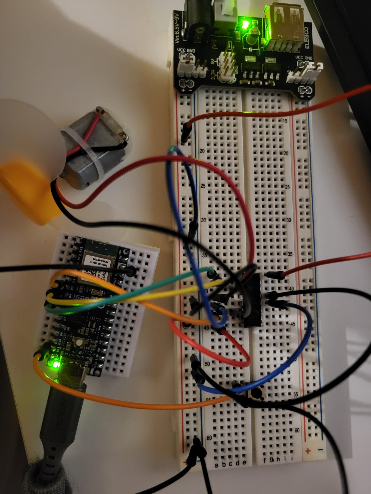
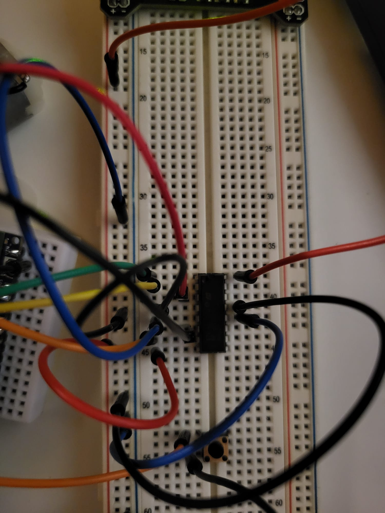
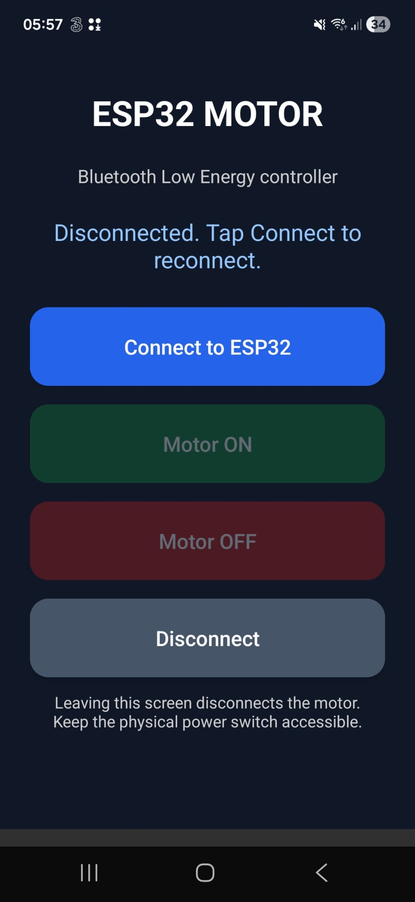

# Arduino Nano ESP32 — Bluetooth Motor Controller

**Project:** 04 — Android BLE Motor Control  
**Date:** 1 November 2026  
**Status:** User confirmed motor operation from the installed Android app  
**Board:** Arduino Nano ESP32 (ABX00083)  
**Phone:** Samsung Galaxy S21 FE

## 1. Overview

An Android application sends ON and OFF commands over Bluetooth Low Energy (BLE). The Nano ESP32 receives them and switches a DC motor through an L293D driver. The external regulated 5 V module powers the driver/motor; USB-C powers the ESP32. All grounds are common.

This project reuses the physical assembly from [Project 03 — FanBlade](../FanBlade/README.md). No motor wiring changes were required. The physical D11 button remains fitted but is unused by this firmware.

## 2. Project files

- [ESP32 firmware](firmware/bluetooth_motor/bluetooth_motor.ino): exact contents of the user's ESP32_Motor_Bluetooth.ino, renamed together with its folder to bluetooth_motor for Arduino IDE compatibility.
- [Android Studio project](android/MotorDC_via_BLT/): actual supplied source project, including Gradle wrapper/configuration and app resources. Generated output, IDE caches, local SDK paths and signing keys are excluded.
- [MainActivity.kt](android/MotorDC_via_BLT/app/src/main/java/com/matiascompany/motordc_via_blt/MainActivity.kt): screen, scanning, GATT connection and ON/OFF writes.
- [AndroidManifest.xml](android/MotorDC_via_BLT/app/src/main/AndroidManifest.xml): BLE permissions and launcher activity.
- [Android build instructions](android/README.md).
- Photos and app screenshot: docs/images/.

The original Android Studio folder, application ID and package names are preserved. The real application package is com.matiascompany.motordc_via_blt, not the earlier example package.

## 3. Hardware and wiring

Components: Nano ESP32, L293D, 3–6 V DC motor with fan blade, Elegoo power module configured for 5 V, compatible adapter, breadboard, jumpers and USB-C cable. The existing push button remains physically present.

| Nano ESP32 / supply | L293D / destination |
|---|---|
| D5 | Pin 1 — EN1,2 |
| D4 | Pin 2 — 1A |
| D3 | Pin 7 — 2A |
| External regulated +5 V | Pins 8 — VCC2 and 16 — VCC1 |
| Common GND | ESP32 GND and L293D pins 4, 5, 12, 13 |
| Motor red lead | Pin 3 — 1Y |
| Motor black lead | Pin 6 — 2Y |

Use printed Nano ESP32 board labels, not raw GPIO numbers. Neither motor lead is permanently ground. The saved firmware sets D4 LOW and D3 HIGH, preserving the user's selected direction.

The previous [KiCad schematic](../FanBlade/hardware/esp32-FanBlade.kicad_sch) remains the hardware reference; it includes the physical D11 button, which this firmware ignores. No separate Bluetooth schematic has been created or claimed as verified.

Keep the external supply separate from the ESP32 VBUS while the board is USB-powered; share GND. Recommended hardware refinements remain the EN pull-down, defined unused driver inputs and supply decoupling described in Project 03. Photos document the actual assembly, not proof that all refinements have been installed.

### Full assembly



*Figure 1. Actual reused breadboard circuit, photographed on 1 November 2026.*

### Motor driver detail



*Figure 2. Close-up of the driver and breadboard wiring.*

## 4. Android interface



*Figure 3. Installed application on the user's phone. The screenshot shows the disconnected state; working control was confirmed separately by the user and serial logs.*

The screen offers Connect to ESP32, Motor ON, Motor OFF and Disconnect. Controls are enabled after discovering the expected service and delivering an initial OFF command. UI delivery messages indicate a successful BLE write, not a measured physical motor state.

## 5. BLE protocol

| Item | Value |
|---|---|
| Advertised device name | ESP32-Motor |
| Service UUID | d8f10001-6a73-4c31-9145-24e3c84f2100 |
| Writable characteristic UUID | d8f10002-6a73-4c31-9145-24e3c84f2100 |
| Command encoding | UTF-8 text |
| Start motor | ON |
| Stop motor | OFF |
| Serial Monitor speed | 115200 baud |

The ESP32 starts with EN disabled. Commands are trimmed and uppercased. Unknown commands request OFF. The motor runs only when connected and commanded ON. On detected disconnection, the firmware requests OFF and resumes advertising.

The app uses writes with response, scans for the service and connects to the first match. Test with one matching ESP32 nearby. It uses BLE, not Bluetooth Classic serial; no Android settings pairing step is required.

## 6. Setup and use

1. Turn motor power off and connect the Nano ESP32 by USB.
2. Open firmware/bluetooth_motor/bluetooth_motor.ino in Arduino IDE.
3. Select Arduino Nano ESP32 and its port, then upload.
4. Open Serial Monitor at 115200 baud and reset once; expect the ready message.
5. Build/install the Android app using the instructions below or in android/README.md.
6. Enable phone Bluetooth, grant Nearby devices permission, open the app and tap Connect to ESP32.
7. Wait for the initial OFF command to complete.
8. For the initial test, remove the blade and secure the motor before enabling external motor power.
9. Tap Motor ON, then Motor OFF. Test Disconnect and reconnect.

The physical button is not used for Bluetooth control. Keep the motor's physical power switch accessible.

## 7. Observed test results

The user installed their APK, connected the phone and confirmed that motor control worked. The supplied serial log included:

```text
Phone connected. Motor OFF.
Received OFF
Received ON
Phone disconnected. Motor OFF.
Waiting for a new connection...
Phone connected. Motor OFF.
Received OFF
Received ON
Received OFF
```

**Confirmed by user feedback:** app-driven motor operation. Logs show ON/OFF reception, disconnection handling and reconnection.

The time from radio loss to physical stop has not been measured. No automatic hardware test or fresh Android/Arduino build was run during this documentation update. Copied source files were verified against their originals.

## 8. Limitations

- The app is designed for Android 12+. The supplied build file still declares minSdk 24; this does not establish compatibility with Android 7–11. The actual source and configuration are preserved, with this mismatch documented.
- Leaving the app screen, locking the phone or recreating the Activity disconnects this foreground-only controller.
- BLE link-loss detection can take seconds. This is not an immediate emergency stop.
- The prototype does not implement pairing/encryption or controller authorization. It is a supervised small-motor experiment, not unattended equipment or mains switching.
- An installable APK was built by the user, but no APK binary or GitHub release is added by this documentation update. Rebuild it from the supplied source.

## 9. Next steps

- Align the Android minimum SDK with the API level required by the implementation.
- Add device authentication and explicit motor-state feedback.
- Record disconnect-to-stop timing and add a command watchdog if required.
- Add speed control and a stop interval before any live direction reversal.
- Optionally publish a versioned APK through GitHub Releases after verifying its source/build match.

## References

- [L293D datasheet](https://www.ti.com/lit/ds/symlink/l293.pdf).
- [Repository license](../LICENSE).
