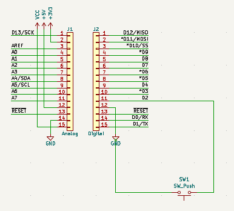
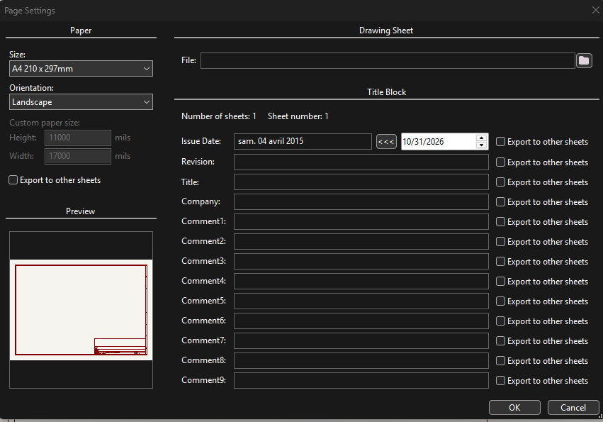

# Arduino Nano ESP32 — Push Button Test

**Project:** 02 — Digital Input  
**Date:** 31 October 2026  
**Status:** Button input tested successfully; Wi-Fi extension not validated  
**Platform:** Arduino Nano ESP32 (ABX00083)  
**Tools:** Arduino IDE, KiCad

## Repository structure

- [Firmware](firmware/button_test/button_test.ino): button-only Arduino sketch.
- [Hardware](hardware/esp32-Button.kicad_sch): supplied KiCad schematic.
- [Schematic screenshot](docs/images/kicad-schematic.png).
- [Page settings screenshot](docs/images/page-settings.png).

## 1. Overview

Read a physical push button using the internal pull-up resistor, report state changes through Serial Monitor and control the onboard LED. This introduces digital inputs, active-low logic and circuit documentation.

## 2. Components

| Component | Quantity | Description |
|---|---|---|
| Arduino Nano ESP32 | 1 | ABX00083 |
| Momentary push button | 1 | Normally open; SW1 |
| Breadboard | 1 | Circuit assembly |
| Jumper wires | 2 | D2 and GND |
| USB-C data cable | 1 | Power and programming |

## 3. Circuit connections

| From | To |
|---|---|
| Nano ESP32 D2 | SW1 terminal 1 |
| SW1 terminal 2 | Nano ESP32 GND |

**Pressed signal path:** D2 → SW1 → GND.

No external resistor is needed: the sketch uses INPUT_PULLUP. Use the board label D2, not GPIO2. A standard four-legged tactile switch has two internally connected pairs; connect contacts from different pairs. Diagonal legs work for the common kit switch. Ensure breadboard strips do not bypass the switch.

### KiCad schematic

[Open the editable schematic](hardware/esp32-Button.kicad_sch).



*Figure 1. Supplied screenshot of SW1 between D2 and GND.*

The drawing uses a classic Nano template. Other pin labels and the complete physical pin mapping remain unverified for the Nano ESP32. Verify them before PCB work. The screenshot is a reference snapshot.

### Page settings reference



*Figure 2. Supplied screenshot of the page-settings editing stage; not confirmation of the saved final title block.*

Suggested title: Nano ESP32 – Push Button Test. Include the board model, USB-C power and INPUT_PULLUP setting as notes.

No assembly photo was supplied and no new picture was generated.

## 4. Arduino source code

Open [button_test.ino](firmware/button_test/button_test.ino) in Arduino IDE. Select Arduino Nano ESP32 and the connected port.

- INPUT_PULLUP holds the released input HIGH.
- Pressing SW1 connects D2 to GND, producing LOW.
- LED_BUILTIN controls the onboard LED.
- Serial messages are printed when the detected state changes.
- The 20 ms delay spaces samples; this is not a full debounce implementation.

| Button state | Reading | Serial output |
|---|---|---|
| Pressed | LOW | Button pressed |
| Released | HIGH | Button released |

## 5. Testing and results

### Procedure

1. Disconnect USB and assemble the circuit.
2. Connect USB, select the board and port, and upload the sketch.
3. Open Serial Monitor at 115200 baud.
4. Press and release the button several times.
5. Verify that messages follow the button state; check the onboard LED separately.

### Observed results

The user reported repeated alternating messages:

```text
Button pressed
Button released
Button pressed
Button released
```

**PASS — Button input and upload confirmed by user feedback.**

LED behavior was not separately confirmed. The saved sketch reproduces the button-only program from the conversation; it has not been compiled or uploaded again during documentation.

## 6. Wi-Fi experiment

A later sketch attempted to host a local webpage showing button state. The button still worked, but the user reported that the webpage did not work. Troubleshooting was set aside.

**Not validated:** the Wi-Fi experiment is not included in the working button-only firmware. An ESP32 local access point does not itself provide internet access.

## 7. Future improvements

- Add software debouncing using millis().
- Count button presses and add a second button.
- Resume Wi-Fi troubleshooting.
- Verify the Nano ESP32 symbol, labels and footprint.
- Add actual assembly and Serial Monitor screenshots when available.
