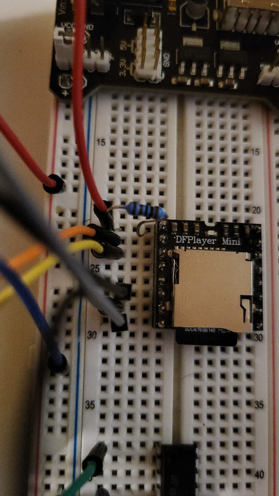

# Arduino Nano ESP32 — DFPlayer Music Player

**Project:** 05 — MP3 Playback  
**Date:** 1 November 2026  
**Status:** Music playback confirmed by user after switching to USB/VBUS power  
**Platform:** Arduino Nano ESP32 (ABX00083)

## 1. Overview

Play an MP3 stored on a microSD card using a DFPlayer Mini, controlled by a Nano ESP32 over UART. The DFPlayer reads/decodes the file and drives a passive speaker through its built-in amplifier. The ESP32 sends commands; it does not generate the recorded audio.

This is a standalone playback test. Bluetooth control is a future extension, not part of the tested project.

## 2. Project files

- [Firmware](firmware/dfplayer_test/dfplayer_test.ino): exact copy of the user-supplied successful DFPlayer_test.ino, saved under a matching lowercase sketch/folder name. Volume is set to 5; original code contents are preserved.
- [Hardware notes](hardware/README.md): final connection table and power arrangement.
- [Initial troubleshooting photo](docs/images/initial-dfplayer-wiring.jpeg): historical external-supply wiring, not the successful final configuration.

No final KiCad schematic or successful-VBUS assembly photo has been supplied yet. No new image was generated. Music files and the full third-party datasheet are not redistributed.

## 3. Components

| Component | Quantity | Notes |
|---|---|---|
| Arduino Nano ESP32 | 1 | ABX00083; USB-C powered |
| DFPlayer Mini | 1 | UART MP3 player with speaker amplifier |
| microSD card | 1 | User card: 16 GB; actual filesystem not confirmed |
| Passive speaker | 1 | Impedance and power rating not verified |
| 1 kohm resistor | 1 | Between ESP32 D3 and DFPlayer RX |
| Breadboard and jumpers | As needed | Interconnections |
| USB-C data cable and USB source | 1 | Programming and working test power |

The Elegoo module with a rectangular 9 V battery was tried during troubleshooting, then disconnected from the DFPlayer supply for the successful USB/VBUS test.

## 4. Wiring and power

| Nano ESP32 / module | DFPlayer |
|---|---|
| VBUS | VCC, no series resistor |
| GND | GND |
| D3 through 1 kohm | RX |
| D4 | TX |
| Speaker red | SPK1 |
| Speaker black | SPK2 |

Use printed board names D3 and D4, not raw ESP32 GPIO numbers. The UART is initialized as begin(9600, SERIAL_8N1, D4, D3): receive first, transmit second.

VBUS provides USB power when the Nano ESP32 is USB-powered. VIN is not the pin used for this arrangement. The external Elegoo 5 V output must not be connected to VBUS in this test.

Both speaker wires connect exclusively to SPK1/SPK2. Neither is a permanent GND. The old L293D and motor connections are not used; disconnect their control wires from D3/D4 before reusing those pins.

Start at low volume. The total USB supply, board power path and DFPlayer current requirements still constrain usable volume. If resets or noise recur, stop playback and investigate power/connections rather than increasing the volume.

## 5. SD card preparation

The command playMp3Folder(1) expects:

```text
SD card root/
├── DCIM/             (other existing documents may remain)
└── mp3/
    └── 0001.mp3
```

The mp3 folder belongs directly at the card root, not inside DCIM. Enable filename extensions in Windows if needed to avoid a doubled extension. The file must contain actual MP3 audio, not another format renamed to .mp3.

For a reproducible setup use a supported card up to 32 GB formatted FAT16/FAT32. Only the user's 16 GB capacity was confirmed during the session; the filesystem was not recorded. Back up personal files before any format operation. Existing unrelated files are not by themselves evidence of a fault.

Safely eject the card and insert/remove it with DFPlayer power disconnected.

## 6. Firmware setup

1. In Arduino IDE install DFRobotDFPlayerMini using Library Manager.
2. Open [dfplayer_test.ino](firmware/dfplayer_test/dfplayer_test.ino).
3. Select Arduino Nano ESP32 and the connected port.
4. With all power disconnected, assemble the VBUS wiring and insert the prepared card.
5. Connect USB and upload; keep other supplies disconnected.
6. Open Serial Monitor at 115200 baud, then press RESET once.
7. After startup the sketch initializes the DFPlayer, sets volume to 5 (range 0–30) and requests /mp3/0001.mp3 once.

Expected messages include Connecting to DFPlayer... and Play command sent: /mp3/0001.mp3. These are expected sketch output, not a captured log of the successful run. A command message alone does not prove audible playback.

If initialization fails, the sketch prints a diagnostic and waits until reset. Runtime playback errors are printed with the library error value.

## 7. Test history and results

| Stage | Observation | Interpretation |
|---|---|---|
| Initial assembly | Resistor placement was questioned and user reported correcting it | Final intended placement: D3 -> resistor -> RX |
| External Elegoo module + rectangular 9 V battery | DFPlayer not detected; speaker made repeating/fading tatatata noise | Power/contact/card causes were investigated |
| RX/TX disconnected | Noise continued | Commands from the ESP32 were not necessary to produce the symptom |
| microSD removed | Noise stopped | Symptom associated with card-present startup; not proof of a faulty card |
| Folder corrected to root mp3 | User reported same symptom | Folder correction alone did not resolve it |
| DFPlayer supply changed to Nano ESP32 VBUS through USB | User confirmed that music played | Working supply arrangement for this test |

**Result: PASS — Audible music playback confirmed by the user.**

The comparison implicates the previous battery/module supply arrangement, but no voltages or currents were measured. A weak battery, regulator behavior and connection resistance were not isolated individually. It would be inaccurate to claim a specific component failure was proven.

### Historical assembly photo



*Figure 1. Earlier wiring using the external module during troubleshooting. This predates the working VBUS configuration and may show connections later corrected. Use the final wiring table, not this photo, for assembly.*

## 8. Learning notes: voltage and current

A 9 V battery label specifies nominal voltage, not unlimited current or available power. Under load, a battery's internal resistance can cause voltage to sag. A regulator can reduce voltage but cannot create unlimited output power; it also has current and thermal limits.

A correctly regulated 5 V source rated for more current than the circuit needs does not force its full rated current through the circuit. The load draws current according to its operation. Direct 9 V on a DFPlayer VCC would exceed its specified supply range; in the failed arrangement the module was intended to regulate the battery voltage first.

## 9. Verification and next steps

This documentation records the user's successful playback report. The saved firmware is an exact copy of the actual sketch supplied by the user and was verified by file hash. No fresh compile or hardware test was performed during documentation.

- Add a final VBUS-powered assembly photo and KiCad schematic.
- Record speaker ratings, SD filesystem and USB source specifications.
- Add play/pause controls, then consider Android BLE commands.
- Verify power requirements before increasing volume or sharing a supply with a motor.

## References

- [DFRobot DFPlayer documentation and pinout](https://wiki.dfrobot.com/dfr0299).
- Local source reviewed during the experiment: A700000006944490.pdf, page 3. Full PDF not included.
- [Repository license](../LICENSE).
