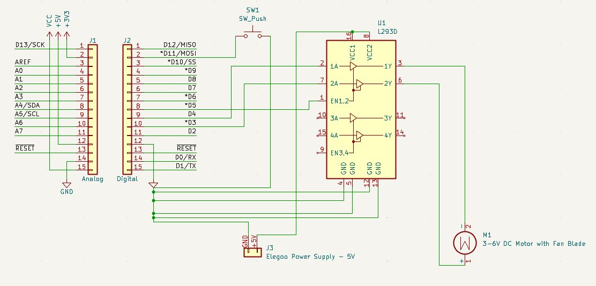
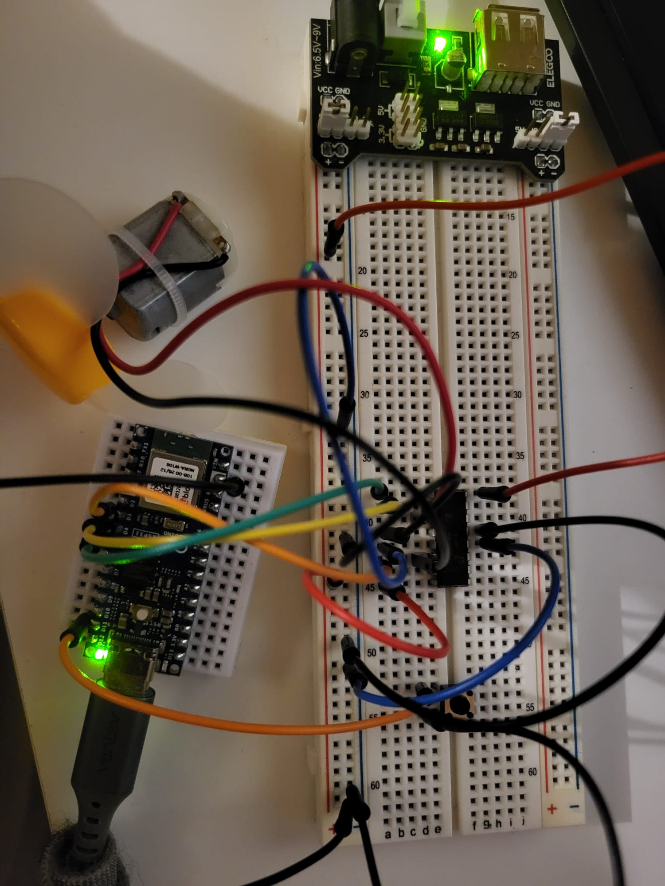

# Arduino Nano ESP32 — Button-Controlled DC Motor

**Project:** 03 — Fan Blade Motor  
**Date:** 31 October 2026  
**Status:** Motor operation confirmed by user; final release-to-stop behavior and reverse rotation not separately confirmed  
**Platform:** Arduino Nano ESP32 (ABX00083)  
**Tools:** Arduino IDE, KiCad 10

## Project files

- [Firmware](firmware/fan_blade_test/fan_blade_test.ino): button-controlled motor sketch.
- [Hardware](hardware/esp32-FanBlade.kicad_sch): supplied editable KiCad schematic.
- [Schematic screenshot](docs/images/kicad-schematic.png): supplied circuit image.
- [Physical assembly photo](docs/images/breadboard-assembly.jpeg): actual reused motor circuit, photographed during the later Bluetooth project.

## 1. Overview

Control a 3–6 V DC motor using a push button and an L293D driver. The intended behavior is to run the motor while the button is held and disable its drive when released. Direction is selected in firmware.

The ESP32 provides control signals. The external regulated 5 V supply provides motor energy through the L293D. The motor must not be driven directly from an ESP32 GPIO.

## 2. Components

| Component | Quantity | Description |
|---|---|---|
| Arduino Nano ESP32 | 1 | ABX00083, USB-C powered |
| L293D | 1 | Dual H-bridge motor driver; U1 |
| DC motor with fan blade | 1 | Rated 3–6 V; M1 |
| Momentary push button | 1 | Normally open; SW1 |
| Elegoo breadboard power module | 1 | Used at regulated 5 V |
| Compatible module power adapter | 1 | Match module input voltage and polarity; kit manual specifies 9 V / 1 A |
| Breadboard and jumper wires | As needed | Circuit assembly |
| USB-C data cable | 1 | ESP32 programming and power |

Motor operating and stall currents have not been measured. L293D and power-module current limits must be respected; successful rotation does not establish continuous-load suitability.

## 3. Circuit connections

### Control signals

| Nano ESP32 board label | Destination | Purpose |
|---|---|---|
| D11 | SW1 terminal 1 | Button input |
| GND | SW1 terminal 2 | Button return |
| D5 | L293D pin 1 — EN1,2 | Enable motor outputs |
| D4 | L293D pin 2 — 1A | Direction input 1 |
| D3 | L293D pin 7 — 2A | Direction input 2 |

INPUT_PULLUP holds D11 HIGH when released. Pressing SW1 connects it to GND and reads LOW. Board labels such as D11 are not raw GPIO numbers.

### Power and motor

| Connection | Destination |
|---|---|
| J3 pin 1 — external +5 V | L293D pins 16 (VCC1) and 8 (VCC2) |
| J3 pin 2 — GND | ESP32 GND and L293D pins 4, 5, 12, 13 |
| Motor red wire | L293D pin 3 — 1Y |
| Motor black wire | L293D pin 6 — 2Y |

Both motor leads connect to driver outputs. Neither motor terminal is permanently GND: the H-bridge can reverse their polarity.

Power the ESP32 through USB-C. Do not connect the external 5 V rail to the ESP32 VBUS while using this arrangement. Share GND. Check breadboard rail continuity because some rails are split in the middle.

J3 represents the module's two-wire output, not its physical adapter-input pinout. The adapter powers the module; never apply the adapter's 9 V directly to the 5 V circuit.

### KiCad schematic



*Figure 1. Supplied schematic with D11 button input, D3/D4/D5 control, external 5 V and shared ground.*

The schematic uses an adapted classic Nano template. Unused board labels are not verified for the Nano ESP32. This is circuit documentation, not a verified PCB design. Electrical-rule checks have not been run during this documentation task.

### Recommended additions, not shown in the supplied schematic

- Ground unused L293D inputs 9, 10 and 15 to define their state; pin 9 LOW disables the unused driver pair. Leave outputs 11 and 14 unconnected.
- Add a 10 kΩ pull-down between pin 1 and GND to disable the motor during reset/upload.
- Add local supply decoupling according to the L293D datasheet, including 100 nF at each supply pin to GND near the IC.

These are recommendations, not claims about components fitted to the tested build. Keep the circuit unpowered when changing wiring and remove the fan blade for initial tests.

### Physical assembly



*Figure 2. Same motor assembly reused for Project 04, photographed on 1 November 2026. The button remains fitted; its behavior depends on the loaded firmware.*

## 4. Firmware and operation

Open [fan_blade_test.ino](firmware/fan_blade_test/fan_blade_test.ino), select Arduino Nano ESP32 and the connected port, then upload. No additional libraries are required.

- EN is set LOW during setup before selecting a direction.
- The button reading must remain stable for 30 ms before the output state changes.
- Holding the button enables the driver; releasing it disables the outputs and the motor coasts down.
- Serial Monitor at 115200 baud prints `Motor on` or `Motor off` on state changes.

### Change direction

With the motor stopped, change this setup pair:

```cpp
digitalWrite(direction1, HIGH);
digitalWrite(direction2, LOW);
```

To:

```cpp
digitalWrite(direction1, LOW);
digitalWrite(direction2, HIGH);
```

Upload again with motor power switched off, then restore motor power for testing. This project does not implement live reversal.

## 5. Test procedure

1. Disconnect USB and switch off the power module before assembly.
2. Check chip orientation, 5 V module setting, both supply pins and common GND.
3. Remove the fan blade and secure the motor.
4. Upload the sketch with motor power off.
5. Open Serial Monitor at 115200 baud and enable motor power.
6. Press the button briefly: verify the motor starts.
7. Release: verify drive stops and the motor slows down.
8. If testing the other direction, stop fully and switch motor power off before changing/uploading firmware.

## 6. Observed results and troubleshooting

Initially, button messages appeared but the motor did not rotate. Inspection identified missing connections on the other side of the driver, especially the pin 16 logic supply. After the missing supply/ground connections were discussed and corrected, the user reported that the motor worked.

**Confirmed:** motor rotation and button input were reported during the session.

**Not separately confirmed:** final hold/release behavior and reverse rotation. The selected saved direction is the original HIGH/LOW pair; the user's last uploaded direction is unknown.

The firmware here is reconstructed from the shared sketch with D11 selected and English serial messages. It has not been compiled or uploaded again during documentation.

The Elegoo lesson's breadboard picture omitted a clear pin 16 supply connection. Always use the driver's pin table, not the picture alone, to check both VCC1 and VCC2.

## 7. Next steps

- Add any further photos needed to show connections clearly; a reused assembly photo is now included.
- Confirm and record release-to-stop and reverse-direction results.
- Add the recommended pull-down, unused-input terminations and decoupling.
- Measure supply voltage and motor current when a meter is available.
- Explore PWM speed control and a direction button with a stop interval before reversal.
- Run KiCad electrical-rule checks and verify board pin mapping before any PCB work.

## References

- [Texas Instruments L293/L293D datasheet](https://www.ti.com/lit/ds/symlink/l293.pdf): pinout, supply requirements and device limits.
- Elegoo Super Starter Kit for UNO V1.0.2019.09.17, Lesson 21 — DC Motors; printed pages 136–144. The full manual is not redistributed here.
- [Repository license](../LICENSE).
