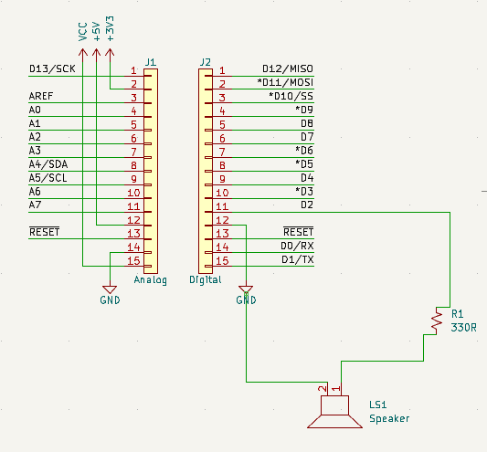
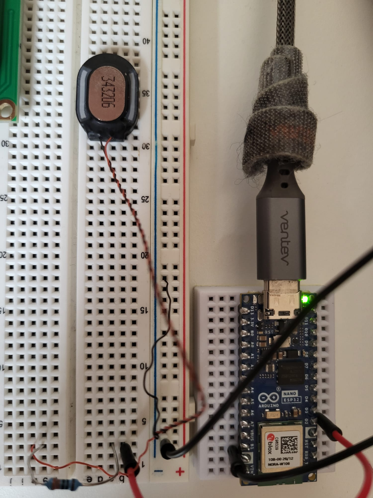

# Arduino Nano ESP32 — Speaker Test

**Project:** 01 — Basic Audio Output  
**Date:** 31 October 2026  
**Status:** Tested successfully  
**Platform:** Arduino Nano ESP32  
**Tools:** Arduino IDE, KiCad 10

## Repository structure

- [Firmware](firmware/speaker_test/speaker_test.ino): Arduino sketch, ready to open in Arduino IDE.
- [Hardware](hardware/esp32-Speaker.kicad_sch): editable KiCad schematic.
- [Assembly photo](docs/images/breadboard-assembly.jpeg): physical circuit reference, embedded below.
- [LICENSE](../LICENSE): repository license.

## Quick start

1. Download or clone the repository.
2. Open the schematic in KiCad to inspect the connections.
3. Open firmware/speaker_test/speaker_test.ino in Arduino IDE.
4. Select Arduino Nano ESP32 and the connected port, then upload.

## 1. Overview

This project demonstrates how to generate simple musical tones using an Arduino Nano ESP32 and a small passive speaker.

The goal was to understand how digital output pins can generate audio signals, build a working circuit on a breadboard, and document the electrical connections using KiCad.

The project successfully produced three musical notes using the Arduino `tone()` function.

## 2. Components

| Component | Quantity | Description |
|---|---|---|
| Arduino Nano ESP32 | 1 | Microcontroller |
| Small speaker | 1 | Audio output; impedance not verified |
| Resistor | 1 | 330 Ω |
| Breadboard | 1 | Circuit assembly |
| Jumper wires | As needed | Electrical connections |
| USB cable | 1 | Programming and power |

## 3. Circuit connections

The speaker is connected to digital pin D2 through a 330 Ω resistor.

| From | To |
|---|---|
| Arduino D2 | 330 Ω resistor |
| 330 Ω resistor | Speaker terminal 1 |
| Speaker terminal 2 | Arduino GND |

**Signal path:** D2 → 330 Ω → Speaker → GND

The resistor limits the electrical current through the circuit. The speaker's impedance and continuous-operation suitability still need to be verified.

### KiCad schematic

[Open the KiCad schematic](hardware/esp32-Speaker.kicad_sch)



*Figure 1. KiCad schematic showing D2, resistor R1 (330 Ω), speaker LS1 and ground.*


### Physical assembly




*Figure 2. Physical breadboard connections used during testing.*

## 4. Arduino source code

Open [speaker_test.ino](firmware/speaker_test/speaker_test.ino) in Arduino IDE.

```cpp
const int speakerPin = D2;

void setup() {
  pinMode(speakerPin, OUTPUT);
}

void loop() {
  tone(speakerPin, 262);  // C4
  delay(400);

  tone(speakerPin, 330);  // E4
  delay(400);

  tone(speakerPin, 392);  // G4
  delay(400);

  noTone(speakerPin);
  delay(2000);
}
```

### How the code works

- `speakerPin` identifies the Arduino digital output pin.
- `tone()` generates a square-wave signal at the selected frequency.
- `delay(400)` maintains each note for approximately 400 milliseconds.
- `noTone()` stops the audio signal.
- The sequence repeats after a two-second pause.

### Frequencies used

| Note | Frequency |
|---|---|
| C4 | 262 Hz |
| E4 | 330 Hz |
| G4 | 392 Hz |

## 5. Testing and results

**Test procedure**

1. Assemble the speaker circuit on the breadboard.
2. Connect the Nano ESP32 to the computer through USB.
3. Select the correct board and port in Arduino IDE.
4. Upload the test program.
5. Listen for the three-note sequence.

**Observed results**

- The sketch ran successfully.
- Three distinct tones were audible.
- Sound quality and volume were satisfactory for the initial test.
- The sequence repeated as expected.

**Result: PASS — Initial audio output test successful.**

This result confirms that the test circuit produced sound. It does not establish the speaker's rated impedance or long-term electrical suitability for direct GPIO driving.

## 6. Arduino IDE screenshot

Arduino IDE screenshot: pending. Add the actual screenshot to docs/images/ when available.


## 7. Future improvements

- Experiment with higher and lower frequencies.
- Add a potentiometer to control pitch.
- Investigate volume control through suitable audio-driver hardware.
- Verify speaker specifications and electrical limits.
- Develop longer melodies and sound effects.
- Explore audio output for future ESP32 projects.

## 8. Conclusion

This project successfully demonstrated basic audio generation using an Arduino Nano ESP32.

It also provided practical experience with breadboard assembly, Arduino programming, component connections, and electronic schematic documentation in KiCad.

The circuit serves as a starting point for future audio-based embedded systems projects.
